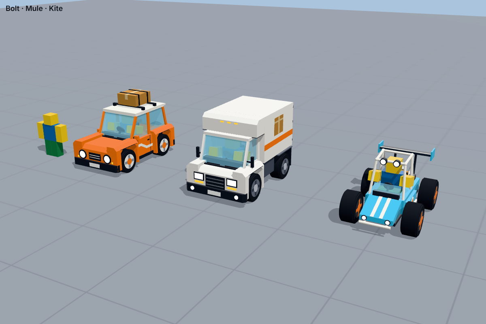
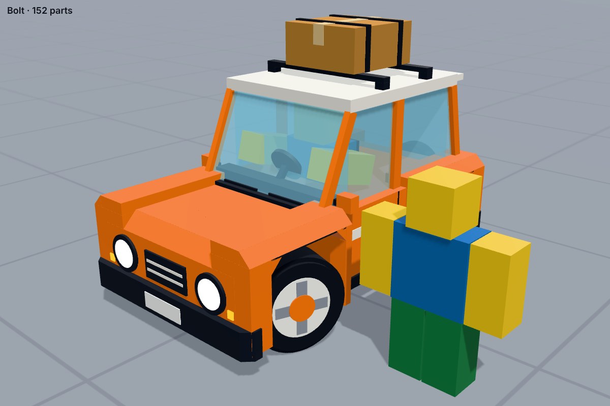
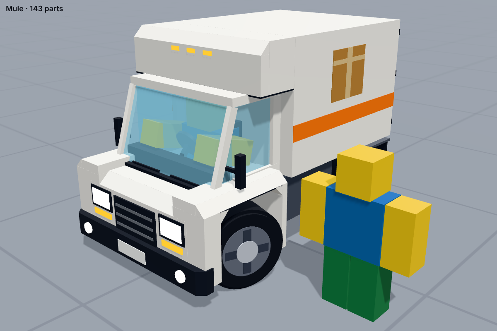
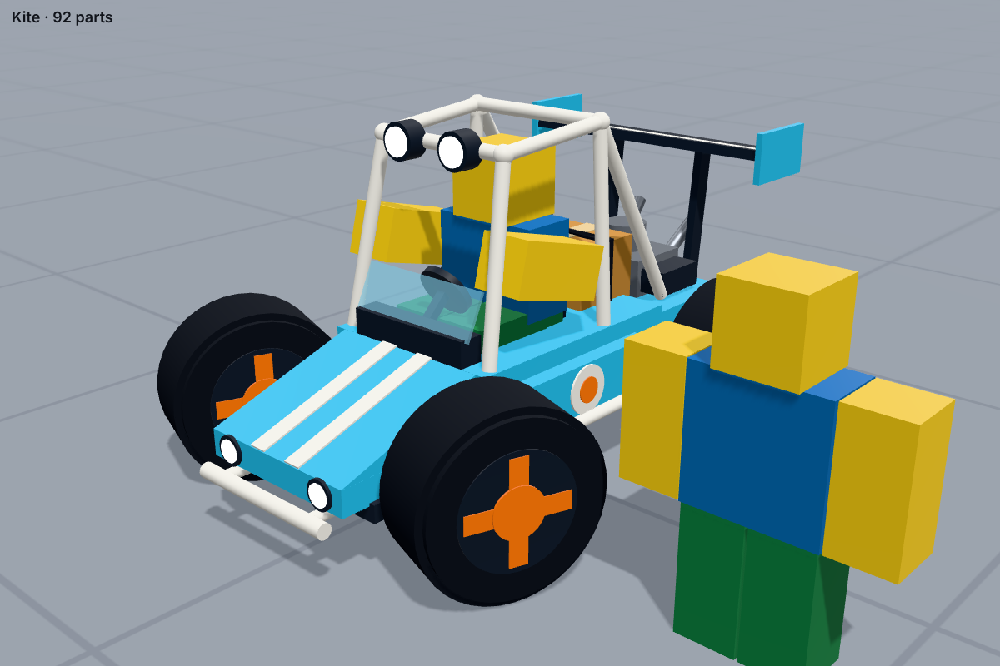

# Delivery game: driving scripts (Roblox)

The base driving for the delivery game, built from the Driving blueprint, and three small,
chunky cars built from plain Roblox parts (no meshes), designed from the Cars blueprint:

| Bolt (starter) | Mule (heavy hauler) | Kite (stunt buggy) |
|---|---|---|
|  |  |  |
| Orange courier 4x4: flared fenders, round headlights, a bolt stripe, a parcel strapped to the roof rack and a spare wheel on the back. | White box van: the cargo box hangs over the cab, an orange stripe and a big parcel logo, barn doors and mud flaps. | Cyan dune buggy: white roll cage with rally lights, open wheels with orange hubs, a crate behind the seat, an open engine and a rear wing. |

Each car is about two avatars long, and your avatar sits inside, visible through the windows.
The handling:

- **Suspension:** one spring per wheel, with ray or sphere casts down from each corner.
- **Engine and speed:** gas, brakes and reverse. The speed curve reaches top speed (115 km/h) in about 3.5 s.
- **Steering:** narrows as you go faster (28° slow, 8° at top speed).
- **Grip, then slide:** normal driving holds the road. The handbrake swings the back out into a drift you can hold.
- **Air:** jumps, air control, flips, clean landings (they auto-straighten), crashes, and a 1-second respawn.
- **Boost:** a meter filled by drifting, airtime, flips and clean landings.
- **Camera:** a chase camera with lag that widens its view at speed, keeps the horizon level in the air, and swings out in drifts.
- **Controls:** keyboard, gamepad and phone buttons.
- **Three cars:** Bolt, Mule and Kite: each has its own look and handling, on the same code.

## What's in here

| File | Goes in Studio as | What it does |
|---|---|---|
| `src/shared/CarConfig.luau` | ModuleScript **CarConfig** | Every tuning number, plus the 3 cars |
| `src/shared/CarMath.luau` | ModuleScript **CarMath** | Small maths helpers |
| `src/shared/CarPhysics.luau` | ModuleScript **CarPhysics** | The driving itself |
| `src/shared/CarInput.luau` | ModuleScript **CarInput** | Keyboard, gamepad and phone input |
| `src/shared/CarCamera.luau` | ModuleScript **CarCamera** | Chase camera |
| `src/shared/CarHud.luau` | ModuleScript **CarHud** | Speed, boost, pop-ups, phone buttons |
| `src/shared/WheelVisuals.luau` | ModuleScript **WheelVisuals** | Spins and steers the wheels for everyone |
| `src/server/CarBuilder.luau` | ModuleScript **CarBuilder** | Builds a car: physics body, seat, wheels |
| `src/server/CarLooks.luau` | ModuleScript **CarLooks** | Draws each car's body and wheels out of parts |
| `src/server/CarServer.server.luau` | Script **CarServer** | Spawns cars, get in/out, parked cars |
| `src/client/CarClient.client.luau` | LocalScript **CarClient** | Starts the driving when you sit in a car |

## Put it in Roblox Studio (by hand)

1. Open Studio and make a new **Baseplate** place.
2. **ReplicatedStorage:** right-click → Insert Object → **Folder**, and name it `CarSystem`.
   Inside it, add 7 **ModuleScripts** named exactly `CarConfig`, `CarMath`, `CarPhysics`,
   `CarInput`, `CarCamera`, `CarHud` and `WheelVisuals`. For each one, delete the starter
   text and paste in the matching file from `src/shared/`.
3. **ServerScriptService:** add a **Folder** named `CarSystem`. Inside it, add:
   - a **Script** named `CarServer`, with `src/server/CarServer.server.luau` pasted in;
   - a **ModuleScript** named `CarBuilder`, with `src/server/CarBuilder.luau` pasted in;
   - a **ModuleScript** named `CarLooks`, with `src/server/CarLooks.luau` pasted in.
4. **StarterPlayer → StarterPlayerScripts:** add a **LocalScript** named `CarClient` and paste
   in `src/client/CarClient.client.luau`.
5. Press **Play**. A car appears in front of you. Walk up to it and press **E** to drive.
   The panel at the top spawns Bolt, Mule or Kite.

Names matter: the scripts find each other by name. If something doesn't load, check the
Output window first; it nearly always points at a misspelled name.

### Or with Rojo

Rojo copies the files into Studio for you and keeps them in sync as they change.

1. Install [Rokit](https://github.com/rojo-rbx/rokit/releases) (the x64 file for most Windows PCs).
2. In a terminal in this `roblox` folder, run `rokit install`. It installs the Rojo version
   listed in `rokit.toml`.
3. Run `rojo serve` and leave it running.
4. In Studio, install the **Rojo** plugin by rojo-rbx (View → Toolbox), and allow it
   **Script Injection** in Plugins → Plugin Manager.
5. Click **Connect** in the Rojo plugin, then **Accept**.

When the scripts here change, replace the files in this folder; Rojo pushes them into Studio
straight away.

## Controls

| | Keyboard | Gamepad | Phone |
|---|---|---|---|
| Gas | W / ↑ | RT | GAS (auto-gas is on by default) |
| Brake, then reverse | S / ↓ | LT | BRAKE |
| Steer | A D / ← → | Left stick | ◀ ▶ |
| Handbrake / drift | Space | A | DRIFT |
| Boost | Shift | X | BOOST |
| Back to checkpoint | R | Y | RESET |
| Switch camera | C | R3 / D-pad up | CAMERA |
| Get out | F | B | GET OUT |
| Driving info (for tuning) | T | | |
| Look around | Hold right mouse | Right stick | Drag on the screen |

**In the air:** W / S flip forward and back, A / D spin, and Space + A / D rolls. Keys you were
already holding when you left the ground (like W) don't tilt the car until you let go, so
holding gas over a jump won't flip you.

**Drifting:** at speed, tap or hold Space while steering. The back end swings out, and the
front wheels countersteer for you. Hold the turn direction to keep the drift (and make it
tighter), or steer the other way to straighten up. Drifting slowly gives a tight circle round
a cone. It costs some speed but fills boost.

## Build a test track (do this before any map)

From the blueprint: one flat lot with a cone slalom, small, medium and big ramps, a banked
turn, a half-pipe, a wall to crash into and an ice patch. Plain parts are fine.

- **Ramps:** use Wedge parts.
  - Medium ramp: about 6 studs high over 24 studs long (about 14°).
  - Big ramp (backflips): needs about 2 seconds of air. Make it **40° or steeper** and hit it fast.
- **Ice patch:** a part with Material **Ice** (grip 0.6). Grass, Sand and Mud count as dirt (grip 0.8).
  Any part can have a number attribute `Grip` to set its own grip.
- **Checkpoints:** an invisible part (CanCollide off) across the road with its front face
  pointing down the road. Add the tag `CarCheckpoint` (Properties → Tags). Crashes and **R**
  bring you back here.
- **Death zones** (water, gaps, off a roof): a part tagged `CarKillZone`. Driving into it
  counts as a crash.

Without checkpoints, you respawn at the last spot where all four wheels were safely on
the ground.

## Tuning

Everything is in **CarConfig**. Change a number, press Play, drive, and repeat. Press **T** while
driving to see live numbers (speed, slide angle, how squashed each spring is, grip).

Most useful knobs:

| What you want | Change |
|---|---|
| Faster / slower | `Engine.TopSpeed`, `Engine.TimeToTopSpeed` |
| Grippier corners | `Tires.Grip` (how hard the tyres can push sideways) |
| Less sliding in general | `Tires.GripRate` |
| Easier / harder drifts | `Drift.RearGrip` (lower = more slide), `Drift.TargetAngle` |
| Twitchy at speed | lower `Steering.MaxAngleFast` |
| Floaty / heavy jumps | `Gravity` (car only; 60 now, Roblox's default is 196.2) |
| Bouncy / stiff suspension | `Suspension.Frequency`, `Suspension.DampingRatio` |
| Leans too much in turns | raise `Tires.ForceHeight` or `Suspension.AntiRoll` |
| Spins faster in the air | `Air.PitchRate`, `Air.RollRate`, `Air.YawRate` |
| Jumps land too easily | lower `Air.AutoLevel` (0 turns the self-levelling off) |
| New paint colours | `Look.Colors` (Paint, Accent, Rim and Hub are the paint slots) |

Speeds are in studs per second (1 stud ≈ 0.28 m, so 1 studs/s ≈ 1 km/h). Mule and Kite only
list what they change from Bolt.

## How it works

- **The driver's device runs the car.** When you sit down, the server gives your device
  control of the car's physics, so it feels instant even with lag. Everyone else sees it move
  normally. When you get out, the server takes the car back and keeps it parked on its wheels.
- **CarPhysics** runs once per frame. It casts down from each wheel, works out the spring push,
  the tyre grip, the engine and the brakes, then sets two forces on the Chassis (`CarForce`
  and `CarTorque`).
- **The wheels you see are just for looks.** Each player's computer spins and steers them
  locally, so they cost nothing on the network.

## How the cars are built

`CarBuilder` makes the parts the physics needs, all invisible: the **Chassis** box (the body you
crash with), a **Cabin** box (so roof landings are real), a hidden weight that sets the centre
of mass, and the seat. Their sizes are `Body` in CarConfig. `CarLooks` then draws everything you
see around them: about 90 to 150 plain parts per car (blocks, wedges, cylinders and balls),
with no mass and no collisions, welded on. The wheels are a tyre part each with a rim, spokes
and hub welded to it; `WheelVisuals` spins and steers them.

To change a design, edit that car's function in `CarLooks` (`hatchback`, `van` or `buggy`).
Drawings use studs with the ground at y = 0 and the front towards -Z. To check your change
without Studio, render it (see `tests/README.md`). Parts in a paint slot carry a `PaintSlot`
attribute, so a paint shop can recolour them later.

## Swapping in a real model later

Keep these names and the driving works unchanged:

- A Model tagged `Car` with a `CarType` attribute (`Bolt`, `Mule` or `Kite`).
- **Chassis:** the main collision part, set as the model's PrimaryPart. It contains:
  - attachments `WheelFL`, `WheelFR`, `WheelRL` and `WheelRR` at the top of each wheel's suspension;
  - `CarForce` (a VectorForce) and `CarTorque` (a Torque).
- **DriverSeat:** a Seat with a `DrivePrompt` ProximityPrompt.
- A **Wheels** folder: one part per wheel, joined to the Chassis by a Motor6D named `Axle`.
  Body parts should be Massless and welded to the Chassis.

The easiest way is to add a new style to `CarLooks` that welds your mesh parts on instead of
drawing the parts.

## Known limits and next steps

- **Only partly tried in Studio.** It was tested here, outside Roblox, with a physics
  simulation, an API checker and 3D renders of the cars (see `tests/`), and every test passes.
  If anything feels or looks off in Studio, write down what you did and what happened.
- If a car shakes or jitters on some surfaces, try `Suspension.CastShape = "Ray"`.
- **Not built yet:**
  - sounds (engine pitch from `physics.Speed`, tyre squeal from `wheel.Sliding`);
  - near-miss boost (call `AddBoost(5)`);
  - package damage (listen for the `Landed` and `Crashed` events);
  - tilt-to-steer on phones.
- Because the driver's device runs the car, a cheater could move their own car. Every Roblox
  driving game has this trade-off. Add server-side speed checks before Versus mode.
